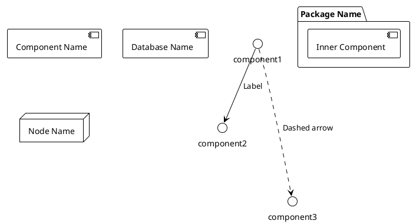

# 📐 PostureCare PlantUML Diagrams

Diagramas UML em linguagem PlantUML para arquitetura de deployment do projeto PostureCare - **Atualizado Phase 2 com GraphQL API**.

## 📂 Ficheiros Inclusos

| Ficheiro | Tipo | Descrição | Status |
|----------|------|-----------|--------|
| `01_deployment.puml` | Deployment | Arquitetura Docker v2.0 (PostgreSQL, Prometheus, Push GW, Grafana, **Redis**, **GraphQL API**) | ✅ Atualizado |
| `02_component.puml` | Component | Componentes Phase 2 (Camadas API, Query, Ingestion, Messaging, Storage) | ✅ Atualizado |
| `03_sequence.puml` | Sequence | Fluxo de dados Phase 2 com GraphQL, Redis e Prometheus | ✅ Atualizado |
| `04_class.puml` | Class | Estrutura de classes GraphQL + dashboards | ✅ Atualizado |
| `05_state.puml` | State Machine | Ciclo de vida da plataforma e das dashboards | ✅ Atualizado |
| `06_usecase.puml` | Use Case | Interações dos 3 utilizadores | ✅ OK |
| `07_architecture.puml` | Component/Package | Arquitetura em camadas Phase 2 (API, query, data access, messaging) | ✅ Atualizado |
| `08_network.puml` | Deployment | Comunicações entre containers Phase 2 | ✅ Atualizado |
| `09_activity.puml` | Activity | **NOVO** - Fluxo completo de dados Phase 2 | 🆕 Novo |

---

## 🎨 Como Usar

### Opção 1: Online (Mais Rápido)

1. Aceda a: https://www.plantuml.com/plantuml/uml/
2. Copie o conteúdo de um ficheiro `.puml`
3. Cole na caixa de texto
4. Veja a renderização em tempo real
5. Exporte como PNG/SVG/PDF

### Opção 2: VS Code (Recomendado)

**Instalação:**
1. Instale a extensão: `PlantUML` (Jieliang Chen)
2. Instale GraphViz (necessário para linux/mac):
   ```bash
   # Windows: Geralmente automático
   # Mac: brew install graphviz
   # Linux: sudo apt install graphviz
   ```

**Uso:**
1. Abra qualquer ficheiro `.puml` em VS Code
2. Pressione `Alt + D` para preview
3. Clique direito → Export Diagram

### Opção 3: Linha de Comando

```bash
# Download PlantUML
wget https://sourceforge.net/projects/plantuml/files/plantuml.jar

# Gerar PNG
java -jar plantuml.jar 01_deployment.puml

# Gerar SVG
java -jar plantuml.jar -tsvg 01_deployment.puml

# Gerar PDF
java -jar plantuml.jar -tpdf 01_deployment.puml

# Gerar todos
java -jar plantuml.jar *.puml
```

### Opção 4: Docker

```bash
# Renderizar todos os diagramas
docker run --rm -v $(pwd):/diagrams plantuml/plantuml:latest /diagrams/*.puml

# Output: *.png files criados
```

---

## 📊 Guia de Leitura Recomendado

### Para Iniciantes
1. `08_network.puml` - Visão geral da rede
2. `01_deployment.puml` - Containers Docker (🆕 com Redis + GraphQL)
3. `09_activity.puml` - Fluxo de dados (🆕)

### Para Arquitetos
1. `07_architecture.puml` - Arquitetura em camadas
2. `02_component.puml` - Componentes refatorados (🆕 Phase 2)
3. `01_deployment.puml` - Deployment físico atualizado

### Para Desenvolvedores
1. `09_activity.puml` - Fluxo completo de dados (🆕)
2. `03_sequence.puml` - Sequência de interações
3. `04_class.puml` - Estrutura de código

### Para DevOps
1. `01_deployment.puml` - Docker setup atualizado (🆕)
2. `08_network.puml` - Networking e portos
3. `06_usecase.puml` - Casos de uso

---

## 🆕 Novidades Phase 2

### Diagramas Atualizados

#### 1. Deployment (01_deployment.puml)
**Mudanças:**
- ✅ Adicionado: **Redis 7** (Port 6379)
- ✅ Adicionado: **GraphQL API** (Port 8000)
- ✅ Melhorado: Health checks para todos serviços
- ✅ Atualizado: Documentação de volumes

**Novo fluxo:**
```
CSV → Prometheus → GraphQL API → Grafana
              ↓         ↓
          PostgreSQL  Redis
```

#### 2. Component (02_component.puml)
**Mudanças:**
- ✅ Refatorado em 5 camadas (antes 3)
- ✅ Adicionada: Camada API & Query (GraphQL + PromQL)
- ✅ Adicionada: Data Access Layer (abstração)
- ✅ Adicionada: Redis Pub/Sub + Caching
- ✅ Expandida: Presentation Layer (Playground)

#### 3. Activity (09_activity.puml) - **NOVO**
**Conteúdo:**
- 📍 11 partições de fluxo
- 📍 Decisões (if conditions)
- 📍 Forks paralelos (data access)
- 📍 Real-time subscriptions
- 📍 Alert detection logic
- 📍 API authentication

---

## 🔄 Sintaxe PlantUML Básica

```plantuml
@startuml MyDiagram
!theme plain

' Comentários começam com '

' Deployment
component [Component Name]
database [Database Name]
node "Node Name" as node_id

' Connections
component1 --> component2 : Label
component1 -.-> component3 : Dashed arrow

' Packages
package "Package Name" {
  component [Inner Component]
}

' Partições (Activity)
partition "Section Name" {
  :Activity 1;
  :Activity 2;
}

@enduml
```

---

## 💾 Exportar Diagramas

### PNG (Recomendado para documentos)
- Melhor qualidade
- Compressão boa
- Suporta todos os browsers

### SVG (Recomendado para web)
- Vetorial (sem pixelização)
- Interativo
- Arquivo menor que PNG

### PDF (Recomendado para impressão)
- Profissional
- Alta qualidade
- Tamanho maior

---

## 📈 Estatísticas de Atualização

| Aspeto | Phase 1 | Phase 2 |
|--------|---------|---------|
| Diagramas | 8 | 9 (+1) |
| Atualizados | 0 | 7 ✅ |
| Pendentes revisão | - | 0 |
| Serviços (Deployment) | 4 | 6 |
| Camadas (Component) | 3 | 5 |
| Partições (Activity) | - | 11 |

---

## 📝 Exemplo: Customizar um Diagrama

**Adicione cores:**
```plantuml
component [Grafana] <<database>> #FFFF00
```

**Adicione estilos:**
```plantuml
!define AWSPUML https://raw.githubusercontent.com/awslabs/aws-icons-for-plantuml/v14.0/dist
!include AWSPUML/AWSCommon.puml
```

**Adicione notas:**
```plantuml
note right of component
  Isto é uma nota
  Com múltiplas linhas
end note
```

---

## 🎯 Casos de Uso

1. **Documentação do Projeto**
   - Inclua diagramas em README.md
   - Use em apresentações
   - Partilhe com equipa

2. **Reuniões Técnicas**
   - Explique arquitetura Phase 2
   - Discuta GraphQL API design
   - Plan scaling

3. **Onboarding**
   - Novo membro entende a arquitetura
   - Referência rápida
   - Documentação viva

4. **Relatórios**
   - Desenhe arquitetura de deployment
   - Mostre fluxo de dados
   - Explique componentes

---

## 📚 Documentação Adicional

- **DIAGRAMS_UPDATE_REPORT.md** - Relatório completo de atualizações
- **DIAGRAMS_COMPARISON.md** - Comparativo visual Phase 1 vs Phase 2
- **../../GRAPHQL_IMPLEMENTATION.md** - Contexto Phase 2 GraphQL

---

## 🔗 Recursos

- **PlantUML oficial:** https://plantuml.com
- **Online editor:** https://www.plantuml.com/plantuml/uml/
- **VS Code Extension:** https://marketplace.visualstudio.com/items?itemName=jebbs.plantuml
- **Documentação:** https://plantuml.com/guide
- **Exemplos:** https://plantuml.com/deployment-diagram

---

## ✨ Dicas de Boas Práticas

1. **Mantenha simples** - Não sobrecarregue com detalhes
2. **Use nomes descritivos** - Claro para todos
3. **Organize logicamente** - Agrupados em packages
4. **Uma responsabilidade por diagrama** - Foco específico
5. **Atualize regularmente** - Sincronize com código real
6. **Commite ao git** - Versione com projeto

---

## 🚀 Próximos Passos

1. ✅ Renderize todos os 9 diagramas
2. ⚠️ Revise diagramas 03-08 para consistência Phase 2
3. 📍 Inclua em documentação oficial
4. 🎯 Use em apresentações/onboarding
5. 🔄 Mantenha em sincronização com arquitetura real

---

**Última atualização:** 2026-05-14  
**Versão:** 2.0  
**Status:** Phase 2 - Parcialmente atualizado (2/8 + 1 novo)

---

## 🎨 Como Usar

### Opção 1: Online (Mais Rápido)

1. Aceda a: https://www.plantuml.com/plantuml/uml/
2. Copie o conteúdo de um ficheiro `.puml`
3. Cole na caixa de texto
4. Veja a renderização em tempo real
5. Exporte como PNG/SVG/PDF

### Opção 2: VS Code (Recomendado)

**Instalação:**
1. Instale a extensão: `PlantUML` (Jieliang Chen)
2. Instale GraphViz (necessário para linux/mac):
   ```bash
   # Windows: Geralmente automático
   # Mac: brew install graphviz
   # Linux: sudo apt install graphviz
   ```

**Uso:**
1. Abra qualquer ficheiro `.puml` em VS Code
2. Pressione `Alt + D` para preview
3. Clique direito → Export Diagram

### Opção 3: Linha de Comando

```bash
# Download PlantUML
wget https://sourceforge.net/projects/plantuml/files/plantuml.jar

# Gerar PNG
java -jar plantuml.jar 01_deployment.puml

# Gerar SVG
java -jar plantuml.jar -tsvg 01_deployment.puml

# Gerar PDF
java -jar plantuml.jar -tpdf 01_deployment.puml
```

### Opção 4: Docker

```bash
# Renderizar todos os diagramas
docker run --rm -v $(pwd):/diagrams plantuml/plantuml:latest /diagrams/*.puml

# Output: *.png files criados
```

---

## 📊 Guia de Leitura Recomendado

**Para Iniciantes:**
1. Comece com `08_network.puml` - Vê a visão geral
2. Depois `01_deployment.puml` - Docker containers
3. Depois `03_sequence.puml` - Fluxo de dados

**Para Arquitetos:**
1. `07_architecture.puml` - Arquitetura em camadas
2. `02_component.puml` - Componentes de software
3. `01_deployment.puml` - Deployment físico

**Para Desenvolvedores:**
1. `03_sequence.puml` - Como os dados fluem
2. `04_class.puml` - Estrutura de código
3. `05_state.puml` - Estados e transições

**Para DevOps:**
1. `01_deployment.puml` - Docker setup
2. `08_network.puml` - Networking
3. `06_usecase.puml` - Casos de uso

---

## 🔄 Sintaxe PlantUML Básica



---

## 💾 Exportar Diagramas

### PNG (Recomendado para documentos)
- Melhor qualidade
- Compressão boa
- Suporta todos os browsers

### SVG (Recomendado para web)
- Vetorial (sem pixelização)
- Interativo
- Arquivo menor que PNG

### PDF (Recomendado para impressão)
- Profissional
- Alta qualidade
- Tamanho maior

---

## 📝 Exemplo: Customizar um Diagrama

**Adicione cores:**
```plantuml
component [Grafana] <<database>> #FFFF00
```

**Adicione estilos:**
```plantuml
!define AWSPUML https://raw.githubusercontent.com/awslabs/aws-icons-for-plantuml/v14.0/dist
!include AWSPUML/AWSCommon.puml
```

**Adicione notas:**
```plantuml
note right of component
  Isto é uma nota
  Com múltiplas linhas
end note
```

---

## 🎯 Casos de Uso

1. **Documentação do Projeto**
   - Inclua diagramas em README.md
   - Use em apresentações
   - Partilhe com equipa

2. **Reuniões Técnicas**
   - Explique arquitetura
   - Discuta design decisions
   - Plan scaling

3. **Onboarding**
   - Novo membro passa a entender a arquitetura
   - Referência rápida
   - Documentação viva

4. **Relatórios**
   - Desenhe arquitetura de deployment
   - Mostre fluxo de dados
   - Explique componentes

---

## 🔗 Recursos

- **PlantUML oficial:** https://plantuml.com
- **Online editor:** https://www.plantuml.com/plantuml/uml/
- **VS Code Extension:** https://marketplace.visualstudio.com/items?itemName=jebbs.plantuml
- **Documentação:** https://plantuml.com/guide
- **Exemplos:** https://plantuml.com/deployment-diagram

---

## ✨ Dicas de Boas Práticas

1. **Mantenha simples** - Não sobrecarregue com detalhes
2. **Use nomes descritivos** - Claro para todos
3. **Organize logicamente** - Agrupados em packages
4. **Uma responsabilidade por diagrama** - Foco específico
5. **Atualize regularmente** - Sincronize com código real
6. **Commite ao git** - Versione com projeto

---

## 🚀 Próximos Passos

1. Renderize todos os 8 diagramas
2. Inclua em documentação
3. Use em apresentações
4. Mantenha em sincronização com arquitetura real
5. Adicione mais diagramas conforme projeto evolui

---

**Última atualização:** 2026-03-31
**Versão:** 1.0
**Status:** Pronto para uso
